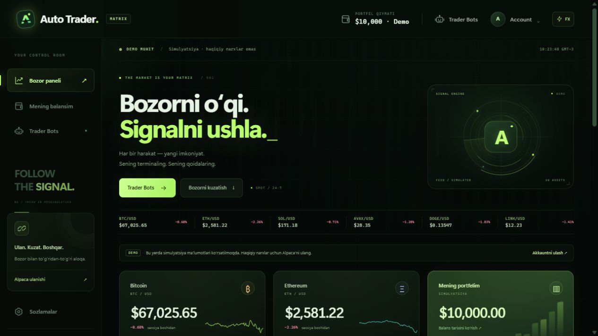

# Auto Trader

Python + Alpaca asosidagi lokal kripto kuzatuv va avtomatik savdo ilovasi. Interfeys o‘zbek tilida. **Trader Bots** ichida bot yaratish, risk sozlamalari, Trend Guard strategiyasi, tarixiy backtest va Alpaca Paper/Live orderlari mavjud. Botlar yaratilganda savdo boshlanmaydi.

## Matrix interfeysi

Neon yashil terminal, shaffof panellar, raqamli yomg‘ir, animatsiyali radar, narx lentasi, yorug‘ grafiklar, kartalarning yengil 3D harakati va ravon sahifa/modal o‘tishlari. Asosiy navigatsiya va savdo qoidalari saqlangan; vizual effektlar savdo endpointlarini chaqirmaydi.

Header’dagi **FX** tugmasi animatsiyalarni sokin rejimga o‘tkazadi; tanlov shu brauzerda saqlanadi. Qurilmaning `prefers-reduced-motion` sozlamasi hisobga olinadi. Tab yashirilganda fon animatsiyasi to‘xtaydi. Savdoni tasdiqlash oynasi joyidan siljimaydi — faqat shaffoflik o‘tishi ishlatiladi. Dizayn uchun qo‘shimcha framework, tashqi font yoki uchinchi tomon skripti kerak emas.



## GitHub’da saqlash

Asosiy repozitoriy: [NitroGamerYT777/TraderBot](https://github.com/NitroGamerYT777/TraderBot), kuzatiladigan branch — `main`. Yakunlangan va tekshirilgan o‘zgarishlar commit qilinib, shu repozitoriyga yuboriladi. Doimiy ish tartibi `AGENTS.md`da yozilgan. Kalitlar, `.local/`, bazalar, virtual muhit va akkaunt ma’lumotlari ko‘rinadigan lokal tekshiruv suratlari Git’dan chiqarilgan. README’dagi dizayn surati alohida demo muhitidan olingan.

## Ishga tushirish (Windows / PowerShell)

Eng oson yo‘l: **`Start Auto Trader.cmd`** faylini ikki marta bosing. Birinchi ishga tushirishda Python 3.10+ va kutubxonalarni yuklash uchun internet kerak. Skript muhitni tayyorlaydi va brauzerni ochadi. Server ishlashi uchun terminal oynasi ochiq tursin.

Yoki terminaldan:

```powershell
python -m venv .venv
.\.venv\Scripts\python.exe -m pip install -r requirements.txt
.\.venv\Scripts\python.exe run.py
```

Brauzerda [http://127.0.0.1:8000](http://127.0.0.1:8000) ni oching. Serverni to‘xtatish: `Ctrl+C`.

Avvalgi versiya ochiq bo‘lsa, o‘sha terminalda `Ctrl+C` bilan to‘xtatib, **Start Auto Trader.cmd** orqali qayta oching va sahifani yangilang. Kalitlar faqat xotirada bo‘lgan bo‘lsa, qayta kiriting. Xavfsiz omborda saqlangan kalitlar avtomatik tiklanadi. Faol botlar restartdan keyin avtomatik savdoga qaytmaydi: ularni qo‘lda davom ettiring.

## Ishlaydigan imkoniyatlar

- Umumiy header: **Auto Trader** bosh sahifaga, balans qiymati **Mening balansim**ga, **Trader Bots** va **Account** tegishli sahifaga olib boradi.
- Kalitsiz demo: 26 ta namunaviy kripto aktiv. Barcha narxlar simulyatsiya deb belgilanadi; ular amaldagi bozor narxlari emas. Demo aktivlar ro‘yxati Alpaca’da savdoga ochiq juftliklar va’dasi emas.
- Account ichidan Alpaca API Key / Secret Key, Paper yoki Live muhiti. Ulanish akkaunt va aktivlar API so‘rovlari bilan tekshiriladi.
- Ulanganda juftliklar `/v2/assets?asset_class=crypto&status=active` dan olinadi. Alpaca `tradable=true` deb qaytargan juftliklar ko‘rsatiladi. Aktivlar soni va kripto savdo huquqi Alpaca, akkaunt va yurisdiksiyaga bog‘liq; minimal 20 ta haqiqiy aktiv kafolatlanmaydi.
- Bitta Alpaca WebSocket oqimi tanlangan aktivlar, BTC/ETH kartalari va faol botlar uchun kerakli juftliklarni qabul qiladi. Obuna ko‘pi bilan 20 ta juftlik bilan cheklanadi; 405 limit xatosida yana qisqaradi. Tanlov o‘zgarsa, shu ulanishda obuna yangilanadi. Uzilganda 1–30 soniyalik kechikish bilan qayta ulanadi. To‘liq aktivlar jadvali va zaxira narxlar REST orqali 25 tadan paketlarda, odatda har 10 soniyada olinadi. Manba har bir qatorda ko‘rsatiladi. Narx — bid/ask o‘rtachasi; 15 soniyadan eski kotirovka eskirgan deb belgilanadi.
- Kompyuter va Alpaca soati farq qilsa, narx yangiligi HTTPS orqali olingan Alpaca javobining `Date` vaqti va monoton taymer asosida baholanadi. Asl kotirovka vaqti saqlanadi, Windows soati o‘zgartirilmaydi, katta farq panelda ko‘rsatiladi. Haqiqatan eski kotirovka yangi deb belgilab qo‘yilmaydi. Grafik namunalari, bot shamlarining yangiligi va kunlik UTC limiti ham ma’lumot manbasi soatiga moslanadi.
- UI 1–10 Hz oralig‘ida yangilanadi; bu provayderdan sekundiga shuncha yangi kotirovka olish kafolati emas. API’ga 10 Hz REST so‘rovi yuborilmaydi.
- 1–6 ta tanlangan aktiv uchun oxirgi 10 daqiqalik foiz grafigi, gistogramma va Pearson korrelyatsiya matritsasi. Narxlar qiyoslash uchun boshlang‘ich qiymatga normallashtiriladi. Korrelyatsiya narx darajalari emas, 1 soniyalik log-daromadlar asosida; barcha tanlangan aktivlarda kamida 30 ta sinxron, yangi interval kerak. Yetarli ma’lumot yoki dispersiya bo‘lmasa `—` ko‘rinadi. Live kuzatuv tarixi ulanishdan boshlab yig‘iladi; restartda tiklanmaydi.
- Balans har 15 soniyada, tarix `/v2/account/portfolio/history` orqali yangilanadi. 1 kun / hafta / oy / yil tanlovi, portfel qiymati va davrlar o‘zgarishi ustunlari. Kripto uchun `intraday_reporting=continuous`, `pnl_reset=no_reset`.
- XAU/USD va UZS/USD alohida manba talab qiladi. Hozir ularni savdo qilish, kuzatish yoki korrelyatsiyaga qo‘shish amalga oshirilmagan; UI buni ochiq ko‘rsatadi.
- **Create A new Trader Bot**: nom, USD kripto juftligi, Paper/Live, sham oralig‘i va risk limitlari. Bot kartasida Boshlash / Pauza / Pozitsiyani yopish / Backtest / Jurnal / Sozlash / O‘chirish mavjud.

## Trader Bots

Avval **Paper** muhiti va kichik virtual budjetda sinang. Yaratishning o‘zi order yubormaydi. **Boshlash** oynasida budjet va riskni tasdiqlash kerak. Live uchun `LIVE Bot nomi`, Live pozitsiyasini yopish uchun `CLOSE Bot nomi` yoziladi. Ko‘rib chiqilgan sozlamalar o‘zgargan bo‘lsa, eski tasdiq qabul qilinmaydi. Paper bot uchun Paper, Live bot uchun Live akkaunt kalitlari kerak. Backtest esa istalgan ulangan Alpaca kalitlari bilan faqat tarixiy ma’lumotni o‘qiydi.

**Trend Guard**: faqat yopilgan shamlarda EMA20 EMA50’ni yuqoriga kessa va RSI14 45–70 bo‘lsa xarid signalidir. EMA20 EMA50’dan pastga tushishi, stop-loss, take-profit yoki kunlik zarar limiti chiqish signalidir. Spot long pozitsiya ishlatiladi; leverage, short, martingale yo‘q. Bot darhol mavjud trendni quvib xarid qilmaydi: boshlangandan keyingi yangi kesishishni kutadi. Strategiyaning foydali ekanligi isbotlanmagan.

Standartlar: **$100 budjet, $25 maksimal pozitsiya, 0.5% risk budjeti, 2% stop-loss, 4% take-profit, 3% kunlik zarar limiti, 4 ta kunlik kirish, 3 sham cooldown, 0.5% maksimal spread, 15 daqiqalik shamlar**. Risk bo‘yicha dastlabki order taxminan $18.52 bilan chegaralanadi. Risk limiti kafolatlangan maksimal zarar emas; uzilish, gap va slippage zararni oshirishi mumkin.

Maksimal pozitsiya qiymati orderdan oldingi ask narxi bo‘yicha mo‘ljaldir. Market orderning yakuniy fill narxi o‘zgarsa, haqiqiy xarajat mo‘ljaldan farq qiladi. Katta spread bo‘lsa kirish o‘tkazib yuboriladi, lekin bu keyingi narx sakrashini kafolatli cheklamaydi.

Botning holati, fill miqdorlari, order niyatlari va oxirgi 200 jurnal yozuvi `.local/bots.sqlite3`da saqlanadi. Order niyati brokerga yuborilishidan **oldin** diskka yoziladi. Noaniq POST javobi `client_order_id` bilan qayta tekshiriladi; order ko‘r-ko‘rona takror yuborilmaydi. Qisman filllar yig‘ilib, bir marta hisobga olinadi. 45 soniyadan ko‘p ochiq qolgan bot orderiga bekor qilish so‘rovi yuboriladi; yakuniy holat kelguncha yangi order berilmaydi. Noaniq order topilmasa, uning Client ID’sini Alpaca’da tekshiring. Baza yoki jurnal xatosi yangi orderlarni bloklaydi.

Bir akkaunt va kripto uchun bitta faol bot, bir dasturda ko‘pi bilan 10 bot. Naqd balans, boshqa botlar budjeti, aktivning minimal miqdori/qadami, yangi kotirovka, tashqi ochiq orderlar va qo‘lda ochilgan pozitsiyalar tekshiriladi. Budjetlar ichki hisob limitlari; haqiqiy subakkaunt yoki bank rezervi emas. Bot uchun ishlatilayotgan kriptoda bir vaqtda qo‘lda savdo qilish tavsiya etilmaydi: mos kelmaydigan pozitsiya aniqlansa savdo kutadi yoki bloklanadi. Bir data papkasida ikkinchi bot jarayoni fayl qulfi bilan bloklanadi; boshqa papkalardan bir akkauntga parallel bot serverlari ochmang.

**Pauza** yangi xaridlarni to‘xtatadi; mavjud pozitsiyaga chiqish qoidalari davom etadi. **Pozitsiyani yopish** faqat bot jurnalidagi miqdor bilan chegaralangan market sell so‘rovini yuboradi. Pozitsiya yoki pending order bor bot o‘chirilmaydi; boshqa akkauntga o‘tish/ulanishni uzish ham bloklanadi. Pauzadagi, bo‘sh bot sozlamalarini o‘zgartirish mumkin; muhit va kriptoni almashtirish uchun yangi bot yaratiladi.

**Stop-loss/take-profit dasturiy, brokerga joylangan mustaqil himoya orderlari emas.** Bot sikli odatda har 5 soniyada boshlanadi, ammo API kechikishi tekshiruvni uzaytiradi. Server, internet yoki narx oqimi to‘xtasa, himoya ishlamaydi. Serverni to‘xtatish ochiq pozitsiyalarni yopmaydi. Restartda botlar pauzada va qo‘lda davom ettirish holatida bo‘ladi; pending orderlar o‘qib tekshiriladi, yangi order avtomatik yuborilmaydi. Bot ochiq pozitsiyalari bo‘lsa `.local/`ni o‘chirmang yoki almashtirmang.

P/L va komissiya **taxminiy**: har tomonga 0.25% komissiya ishlatiladi. Haqiqiy Alpaca komissiyasi tier, valyuta va hisobga yozilish vaqtiga bog‘liq; kichik crypto/rounding qoldiqlari bo‘lishi mumkin. Yakuniy hisob uchun Alpaca statement/activities’dan foydalaning. Kunlik zarar va kirishlar hisoblagichi **UTC kunlari** bo‘yicha yuritiladi.

**Backtest** eng yangi 1000 tagacha tarixiy shamni ishlatadi; 100 ta sham indikatorlarni boshlash uchun ajratiladi. Signal sham yopilishida, bajarilish keyingi sham ochilishida: kelajak narxi ishlatilmaydi. Har tomonga 0.25% taxminiy komissiya va 0.10% slippage olinadi. Bitta shamda stop va take tegsa, konservativ ravishda stop birinchi hisoblanadi. Drawdown sham yopilishidagi equity asosida, ochiq pozitsiya esa oxirgi close’da baholanadi. OHLC haqiqiy order book va fill navbatini qayta yarata olmaydi. Namuna qisqa va savdolar kam bo‘lishi mumkin; natija out-of-sample tekshiruvi yoki kelajak daromadining isboti emas. Backtest brokerga order yubormaydi.

## Kalitlar va lokal foydalanish

Kalitlarni chatga yoki kodga yozmang. Account formasidan kiriting. Kalitlar brauzer `localStorage`iga yoki `.local/settings.json` fayliga yozilmaydi. Standart holatda faqat Python jarayoni xotirasida turadi. **Saqlash** tanlansa, `keyring` orqali Windows Credential Manager’da bitta `AutoTrader.Alpaca` yozuvida saqlanadi va server qayta ochilganda tiklanadi. Mos xavfsiz ombor bo‘lmasa saqlash rad etiladi; saqlashni o‘chirib ulash mumkin. Ulanishni uzish saqlangan kalitlarni ham o‘chiradi. Boshqa OS’da `keyring` ombori sozlangan bo‘lishi kerak.

Server `127.0.0.1`ga bog‘langan; internetga ochish uchun mo‘ljallanmagan. So‘rovlar jarayon tokeni, Origin va Host tekshiruvlari bilan himoyalanadi. Kalitlar API javoblari va odatiy xato matnlarida qaytarilmaydi. Oddiy sozlamalar `.local/`da saqlanadi; bu papka Git’dan chiqarilgan. `AUTO_TRADER_DATA_DIR` bilan sozlamalar papkasini almashtirish mumkin.

Live muhitni tanlash akkaunt ma’lumotlarini o‘qishga ulanadi. **Live botni tasdiqlab boshlash esa real pul bilan avtomatik xarid va sotishga ruxsat beradi.** Daromad kafolatlanmaydi. Balans o‘zgarishiga depozit va yechib olishlar ham ta’sir qiladi. Yangilanishni ishlab chiqishda foydalanuvchining haqiqiy broker orderlari yuborilmadi; avtomatik savdo testlari almashtirilgan broker javoblari bilan bajariladi.

## Tekshirish

```powershell
.\.venv\Scripts\python.exe -m pip install -r requirements-dev.txt
.\.venv\Scripts\python.exe -m pytest -q
node --check static/app.js
node --check static/bots.js
node --check static/matrix.js
```

Testlar Alpaca HTTP javoblarini almashtirib tekshiradi: API xavfsizligi va bozor tahlili, bot CRUD, risk/miqdor, Live tasdiq, akkaunt mosligi, pauza va restart, takroriy order, qisman fill, noaniq POST, disk xatosi, jarayon qulfi, spread/kunlik limit, backtestda look-ahead yo‘qligi, API order shakli va shamlar pagination’i. Haqiqiy brokerga Paper yoki Live order yuborish bu tekshiruvlar doirasida bajarilmaydi.

Bozor oqimi regressiya testlari 73 ta aktivni cheklangan obunaga ajratish, obunani shu ulanishda almashtirish, 405 dan tiklanish, REST paketlari, noto‘g‘ri juftlikni ajratish, 8 soatlik soat farqi va eski REST narxining yangi WebSocket narxini almashtirmasligini tekshiradi. Narx oqimi tuzatilganda haqiqiy Alpaca ma’lumotlari bilan BTC/ETH oqimi va to‘liq narxlar ro‘yxati ham tekshirildi; savdo orderi yuborilmadi.

## Tuzilishi

`app/main.py` — lokal server, ulanish va sozlamalar. `app/alpaca.py` — Alpaca REST/WebSocket/orderlar. `app/market.py` — demo va tahlil. `app/bots.py` — bot dvigateli va SQLite jurnali. `app/strategies.py` — indikatorlar, risk hajmi va backtest. `static/` — HTML/CSS/JavaScript interfeys. `tests/` — integratsion va hisoblash testlari.

## Rasmiy hujjatlar

- [Alpaca authentication](https://docs.alpaca.markets/us/v1.1/docs/authentication-1)
- [Crypto spot trading va aktivlar](https://docs.alpaca.markets/us/docs/crypto-trading)
- [Real-time crypto WebSocket](https://docs.alpaca.markets/us/docs/real-time-crypto-pricing-data)
- [Portfolio history](https://docs.alpaca.markets/us/reference/getaccountportfoliohistory-1)
- [Crypto orderlar](https://docs.alpaca.markets/us/docs/crypto-orders)
- [Order client ID orqali tekshirish](https://docs.alpaca.markets/us/reference/getorderbyclientorderid)
- [Tarixiy kripto shamlar](https://docs.alpaca.markets/us/reference/cryptobars-1)
- [Kripto komissiyalari](https://docs.alpaca.markets/us/docs/crypto-fees)


### Pulse Micro

Sekundlik snapshotlar ustida EMA 4/12 va 10 soniyalik momentum filtri. Kamida 30 soniyalik uzluksiz ma’lumot talab qilinadi. Dvigatel har 5 soniyada tekshiradi. UI orqali 1–5 order/min yuqori chegarasi, sekundlik cooldown, momentum chegarasi va kunlik kirishlar limiti sozlanadi. Xarid va sotuv alohida order; chiqish sotuvlari xavfsizlik uchun tezlik chegarasidan ozod. Tezlik limiti jurnalga POSTdan oldin yoziladi va restartdan keyin saqlanadi. Bu majburiy savdo kvotasi emas.

Soatlik maqsad (yangi Pulse botda 10%, eski botda o‘chiq) bot budjetiga nisbatan taxminiy kapital o‘zgarishidir: realized + bidda baholangan ochiq P/L, taxminiy komissiyadan keyin. UTC soati almashganda baza yangilanadi. Maqsadga yetganda pozitsiya yopishga urinish va shu soat oxirigacha yangi xaridlar bloklanishi amalga oshadi. Fill, spread, fee va slippage sabab yakuniy natija maqsaddan farq qiladi. **10%/soat foyda kafolatlanmaydi; strategiyaning daromadliligi isbotlanmagan.** Pulse uchun sham backtesti ko‘rsatilmaydi: sekundlik tick replay yoki Paper forward sinov kerak. Hech qanday mavjud bot avtomatik yangi strategiyaga o‘tkazilmaydi yoki ishga tushirilmaydi.
